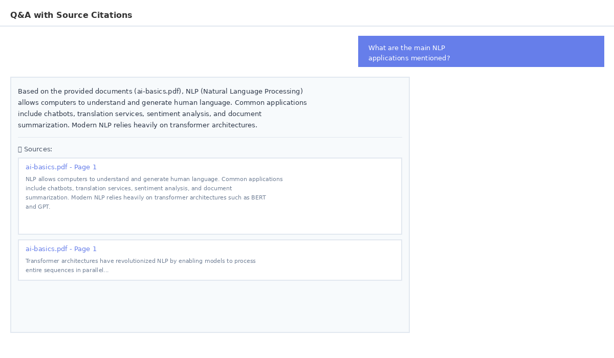
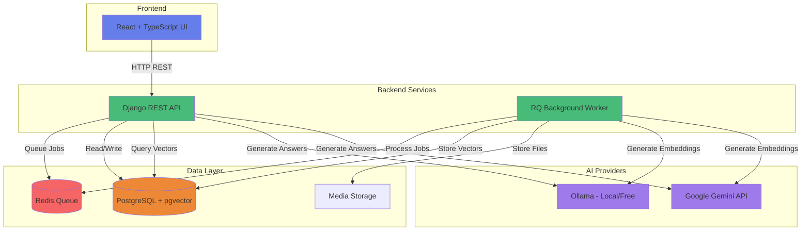

# Docs Q&A

Ask questions about your PDFs in natural language using RAG (Retrieval-Augmented Generation).

[](https://github.com/candeladengra/docs-qa/actions/workflows/ci.yml)


*UI mockup: Upload documents, track processing status, and ask questions (demo with fake provider)*



*Answer with source citations showing document name and page numbers (demo with fake provider)*

## Features

- PDF upload with async background processing
- Natural language question answering with source citations
- RAG pipeline with vector similarity search (pgvector)
- Real-time document processing status updates
- Pluggable AI providers (local Ollama or cloud Gemini API)
- Comprehensive test coverage

## Architecture



## Tech Stack

### Backend
- **Django 5.0** - Web framework
- **Django REST Framework** - API development
- **PostgreSQL + pgvector** - Vector database for embeddings
- **Redis + django-rq** - Async task queue
- **PyPDF2** - PDF text extraction
- **Ollama / Google Gemini** - AI providers (embeddings + chat)

### Frontend
- **React 18** - UI framework
- **TypeScript** - Type safety
- **Vite** - Build tool
- **Axios** - HTTP client

### Infrastructure
- **Docker Compose** - Container orchestration
- **GitHub Actions** - CI/CD
- **pytest** - Backend testing
- **Vitest** - Frontend testing

## Getting Started

### Prerequisites

- **Docker** and **Docker Compose** installed
- **Ollama** installed on your host machine (for free local AI)
  - Install from [ollama.ai](https://ollama.ai)
  - Pull required models:
    ```bash
    ollama pull llama3.2
    ollama pull nomic-embed-text
    ```

Alternatively, use **Google Gemini API** (free tier available at [makersuite.google.com](https://makersuite.google.com/app/apikey)).

### Quick Start

1. **Clone the repository**
   ```bash
   git clone https://github.com/USERNAME/docs-qa.git
   cd docs-qa
   ```

2. **Set up environment variables**
   ```bash
   cp .env.example .env
   # Edit .env if needed (default uses Ollama)
   ```

3. **Start all services**
   ```bash
   docker-compose up --build
   ```

4. **Access the application**
   - Frontend: [http://localhost:5173](http://localhost:5173)
   - Backend API: [http://localhost:8000/api/documents/](http://localhost:8000/api/documents/)
   - Django Admin: [http://localhost:8000/admin/](http://localhost:8000/admin/)

5. **(Optional) Create a superuser** for Django admin access:
   ```bash
   docker-compose exec web python manage.py createsuperuser
   ```

Upload a PDF and start asking questions.

## Usage

1. **Upload a PDF document** using the upload form
2. **Wait for processing** - the document status will update automatically
3. **Ask questions** in the chat interface once documents are ready
4. **View citations** - answers include source references with page numbers

### Example Questions
- "What are the main topics covered in this document?"
- "Summarize the key findings"
- "What does the document say about [specific topic]?"

## Configuration

### Using Ollama (Default - Free & Local)

No additional configuration needed if Ollama is running on your host machine.

```env
AI_PROVIDER=ollama
OLLAMA_BASE_URL=http://host.docker.internal:11434
OLLAMA_CHAT_MODEL=llama3.2
OLLAMA_EMBEDDING_MODEL=nomic-embed-text
```

### Using Google Gemini API

Get a free API key from [Google AI Studio](https://makersuite.google.com/app/apikey).

```env
AI_PROVIDER=gemini
GEMINI_API_KEY=your-api-key-here
```

## Running Tests

### Backend Tests
```bash
cd backend
pip install -r requirements.txt
pytest --cov=apps
```

### Frontend Tests
```bash
cd frontend
npm install
npm test
```

### All Tests via Docker
```bash
docker-compose run web pytest
docker-compose run frontend npm test
```

## Design Decisions

### Why RAG?
Simple LLM API calls can't answer questions about private documents. RAG combines:
- **Retrieval**: Find relevant chunks using vector similarity
- **Augmentation**: Provide those chunks as context
- **Generation**: LLM generates accurate, grounded answers

### Provider Abstraction
Clean interface allows switching between AI providers without changing application logic:
- **Development**: Use free local Ollama
- **Production**: Scale with cloud APIs (Gemini)
- **Testing**: Use fake provider without real LLM calls

### Async Processing
PDF processing (extraction, chunking, embedding) runs in background workers:
- ✅ Fast upload response
- ✅ Non-blocking API
- ✅ Better user experience

### pgvector
PostgreSQL extension for vector operations enables:
- Efficient similarity search
- Native SQL queries
- No separate vector database needed

## Project Structure

```
docs-qa/
├── backend/                    # Django backend
│   ├── apps/
│   │   └── documents/         # Main app
│   │       ├── ai_providers/  # AI provider abstraction
│   │       ├── migrations/
│   │       ├── tests/         # Pytest tests
│   │       ├── models.py      # Document & Chunk models
│   │       ├── serializers.py # DRF serializers
│   │       ├── services.py    # Business logic (RAG)
│   │       ├── tasks.py       # Background tasks
│   │       └── views.py       # API endpoints
│   ├── config/                # Django settings
│   └── requirements.txt
├── frontend/                  # React frontend
│   ├── src/
│   │   ├── components/       # UI components
│   │   │   ├── __tests__/   # Vitest tests
│   │   │   ├── ChatInterface.tsx
│   │   │   ├── DocumentList.tsx
│   │   │   └── DocumentUpload.tsx
│   │   ├── services/        # API client
│   │   ├── types/           # TypeScript types
│   │   └── App.tsx
│   └── package.json
├── docker-compose.yml        # Full stack orchestration
└── .github/workflows/ci.yml  # CI/CD pipeline
```

## Roadmap

Future enhancements to consider:

- [ ] **Multi-document queries**: Ask questions across multiple documents
- [ ] **Document collections**: Organize documents into folders/tags
- [ ] **Advanced chunking**: Semantic chunking with overlap optimization
- [ ] **More AI providers**: OpenAI, Anthropic, local models via Hugging Face
- [ ] **Authentication**: User accounts and document ownership
- [ ] **Chat history**: Persist conversation history
- [ ] **Export answers**: Download Q&A as PDF/Markdown
- [ ] **Streaming responses**: Real-time answer generation
- [ ] **Document comparison**: Compare answers across multiple docs
- [ ] **OCR support**: Extract text from scanned PDFs

## License

MIT License - feel free to use this project for your portfolio or learning purposes.

## Author

**Candela Dengra**  
Full-Stack Developer | Python/Django + React/TypeScript

- Portfolio: [your-portfolio.com](#)
- LinkedIn: [linkedin.com/in/yourprofile](#)
- GitHub: [@yourusername](#)

